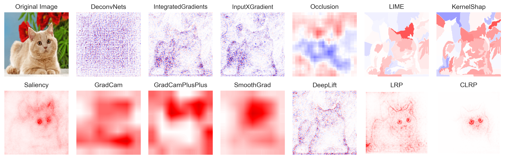
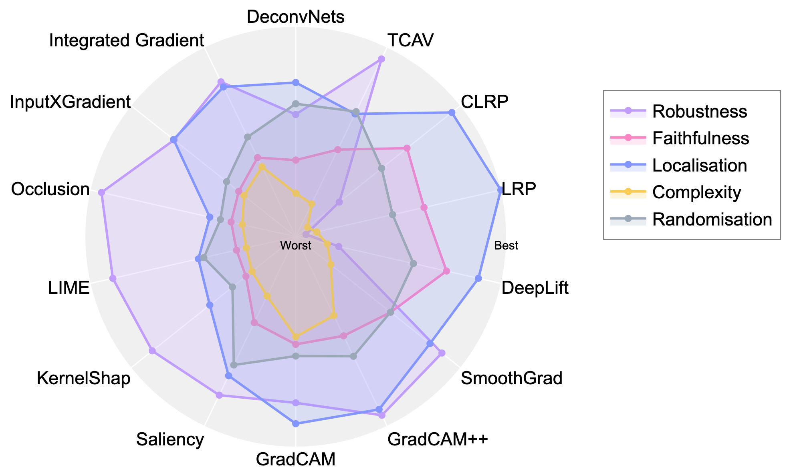

# Survey: Post-hoc XAI Visualization & Evaluation

A comparison of post-hoc explainability (XAI) methods on a pretrained VGG16 / ImageNet
classifier: qualitative attribution maps plus quantitative evaluation with
[Quantus](https://github.com/understandable-machine-intelligence-lab/Quantus) and
[Captum](https://captum.ai/)

## Qualitative comparison

Attribution maps produced by each method for a sample ImageNet image (VGG16):

| Category | Methods |
|---|---|
| Perturbation-based | DeconvNet, Integrated Gradients, InputXGradient, Occlusion, KernelSHAP, LIME |
| Gradient-based | Saliency, GradCAM, GradCAM++, SmoothGrad (on GradCAM++) |
| Decomposition-based | DeepLift, LRP, CLRP (contrastive LRP) |

## Quantitative comparison

Metrics covered:
- **Robustness** : Average Sensitivity
- **Faithfulness** : Sufficiency
- **Localisation** : Pointing Game
- **Complexity** : Sparseness
- **Randomisation** : Random Logit

## Reference

D. Bhati, M. Amiruzzaman, Y. Zhao, A. Guercio, and T. Le, ["A Survey of Post-Hoc XAI Methods From a Visualization Perspective: Challenges and Opportunities"](https://ieeexplore.ieee.org/stamp/stamp.jsp?tp=&arnumber=11039632), *IEEE Access*, 2025.

